# Workload-Aware Routing for Multimodal LLM Inference on Heterogeneous Machines

Profiling and routing a multimodal LLM (**Qwen2.5-Omni-3B**: chat, long text, images, audio) served by **llama.cpp** across a heterogeneous AWS cluster: Intel Sapphire Rapids with AMX, Intel Ice Lake, AMD Genoa, ARM Graviton4, and an NVIDIA L4 GPU.

On a 3-node cluster at 90% load, a router that predicts each request's completion time on each node cut **p95 latency from 240 s (round robin) to 67 s**, was the only policy that kept up with the offered load, and cost **19% less per 1,000 requests**.

**Stack:** Python, llama.cpp / `llama-server` (CPU and CUDA builds, a C++ patch for per-stage timing), GGUF quantization (f16, Q8_0, Q4_K_M), AWS EC2, Bash, pandas, matplotlib.

**What it covers:** inference benchmarking (TTFT, prefill and decode throughput, p95 latency, queueing), continuous batching, quantization trade-offs, cost-model-based request routing, open-loop traffic generation, and prefill/decode disaggregation with KV-cache transfer between nodes.

## Results

All numbers come from measured runs on EC2. Raw per-request data is in [`results/`](results/), and every figure is regenerated by a script in [`analysis/`](analysis/).

### 1. No machine is fastest for every request

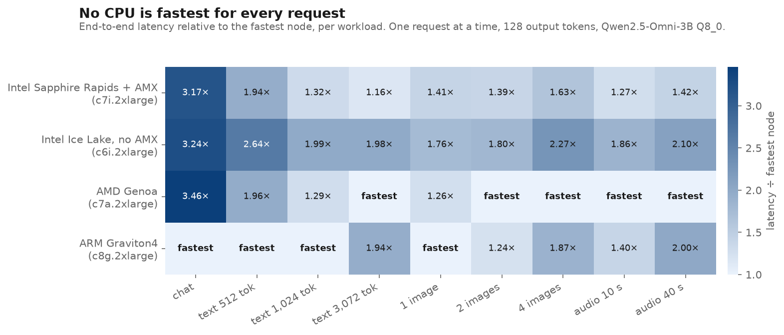

ARM Graviton4 answers chat fastest, but AMD Genoa is fastest on long text, multiple images and audio. The best node depends on the request, which is what makes routing worthwhile.

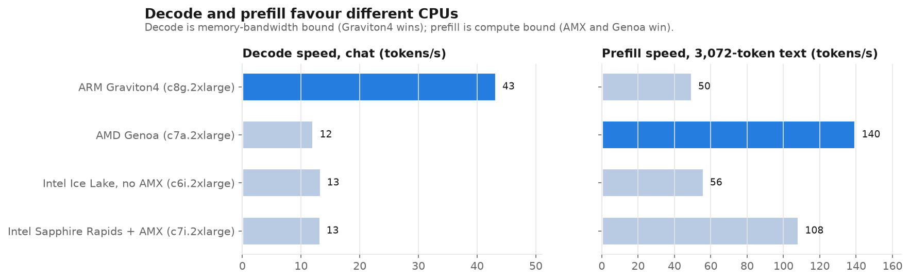

The reason: decode is bound by memory bandwidth, where Graviton4 is about 3× faster, while prefill is bound by compute, where AMX and Genoa win.

### 2. Request-aware routing halves tail latency under load

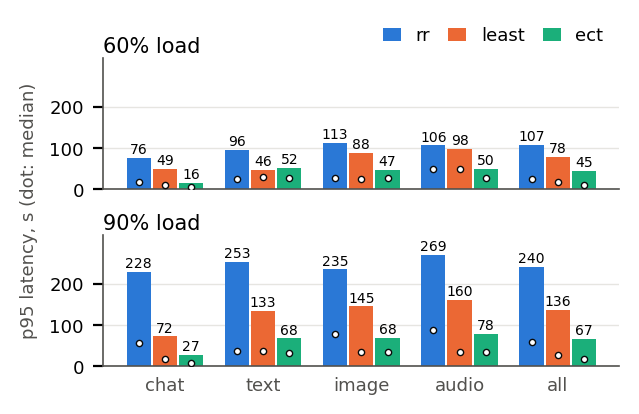

Three policies replay the same open-loop Poisson trace (50% chat, 20% text, 15% image, 15% audio) on a c7a + c7i + m8g cluster: round robin (`rr`), least loaded (`least`), and minimum expected completion time (`ect`). Knowing node load (`least`) roughly halves p95 latency compared with round robin, and also knowing the request (`ect`) halves it again.

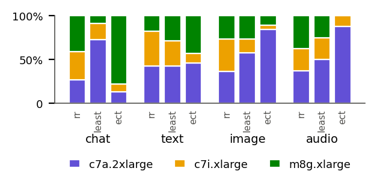

`ect` learns the hardware strengths on its own: it sends 78–88% of chat to the Graviton node and 84–100% of images and audio to the AMD node.

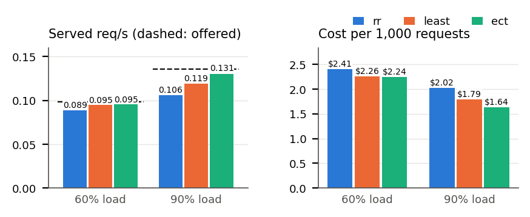

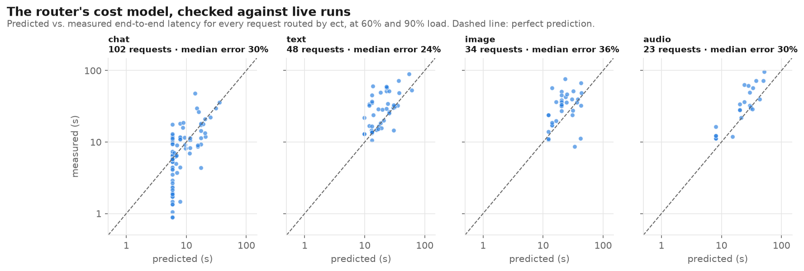

`ect`'s cost model is built only from profiles of requests running alone. It underestimates latency under load (most points sit above the line), but it ranks nodes well enough to route correctly.

### 3. CPU vs GPU serving: queueing vs batching

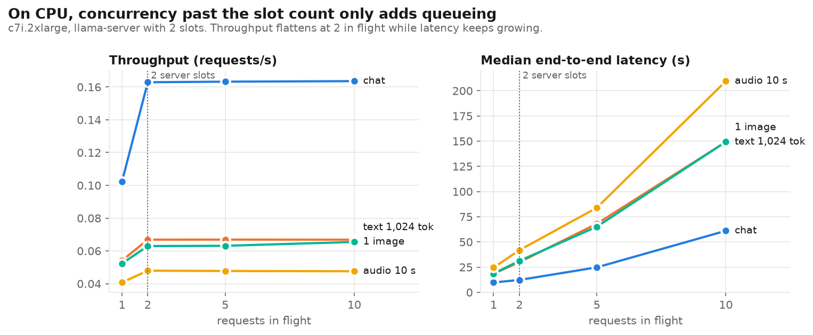

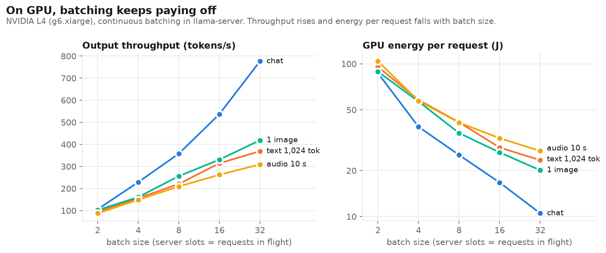

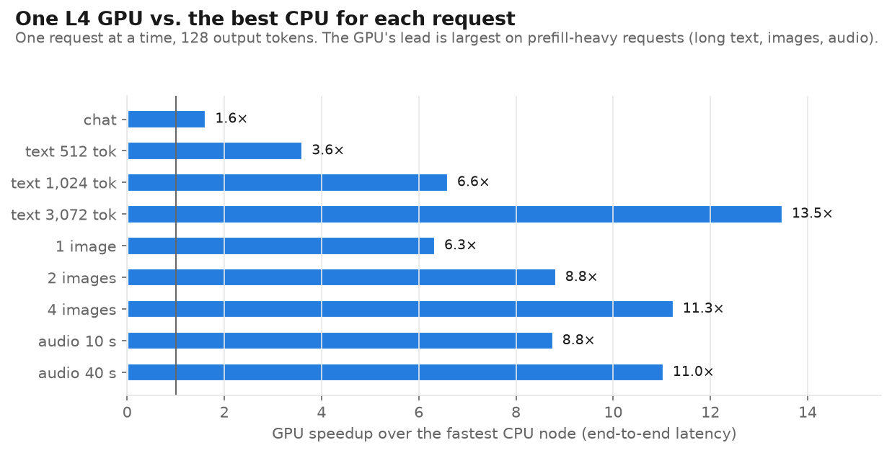

On CPU, throughput stops rising once the requests in flight match the server's slot count, and extra requests only wait in the queue. On the L4 GPU, continuous batching keeps raising throughput up to 32 concurrent requests, and energy per request drops about 8× for chat. The GPU's lead is largest on prefill-heavy requests: 13.5× on 3,072-token text, but only 1.6× on chat.

### 4. Hardware sizing and quantization

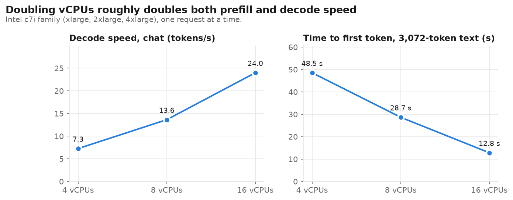

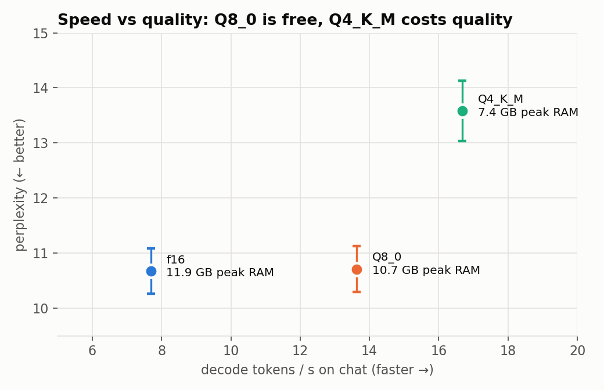

Doubling vCPUs roughly doubles both prefill and decode speed, while extra memory (32 or 64 GB instead of 16 GB) made no difference. Q8_0 matches f16 quality at 1.8× the decode speed. Q4_K_M is faster again, but its answer quality drops noticeably.

## How the router works

[`src/router.py`](src/router.py) implements the policies; [`src/main.py`](src/main.py) replays a trace against the live cluster or simulates every policy on it.

- **`rr`** sends requests to the nodes in turn.
- **`least`** picks the node with the fewest requests in flight per slot.
- **`ect`** predicts, for every node, when the request would finish: the work already queued there plus this request's time on that node (from per-node, per-workload profiles, scaled by the node's measured slot gain). It picks the earliest.

**In progress (Phase 2):** extending the cost model with per-stage timing (encode, prefill, decode) from a patched `llama-server`, the network cost of moving requests and KV caches, splitting one request across two nodes (prefill where prompts are fastest, decode where tokens are fastest), and slowdowns between requests sharing a node. Design: [`docs/phase2-experiment-plan.md`](docs/phase2-experiment-plan.md).

## Repository layout

```
src/            benchmark client, router, trace generator, cluster runner, server setup (run.sh)
analysis/       figures and write-ups: figures/, routing/, quantization/, phase2/, plot.ipynb
results/        raw measurements: phase1/ (per-node profiles), routing/, quality/
docs/           methodology for each experiment, cluster runbook, reproduction steps
traces/         the open-loop traffic traces replayed by every routing policy
patches/        llama.cpp patch that reports per-request encoding time
```

**Docs:** [baseline benchmarks](docs/baseline-benchmark.md) · [routing benchmarks](docs/routing-benchmark.md) · [GPU benchmark](docs/gpu-benchmark.md) · [setup, reproduction and file layout](docs/reproduce.md) · [cluster runbook](docs/routing-cluster-runbook.md)

## References

**Related work**

- ModServe: Modality- and Stage-Aware Resource Disaggregation for Scalable Multimodal Model Serving. [arXiv:2502.00937](https://arxiv.org/abs/2502.00937)
- Rocks, Pebbles, and Sand (RPS Serve). [arXiv:2603.26498](https://arxiv.org/abs/2603.26498)
- Salesforce AI Research, Enterprise Realtime Voice Agent. [GitHub](https://github.com/SalesforceAIResearch/enterprise-realtime-voice-agent)

**Model and runtime**

- Qwen2.5-Omni-3B GGUF weights: [ggml-org/Qwen2.5-Omni-3B-GGUF](https://huggingface.co/ggml-org/Qwen2.5-Omni-3B-GGUF)
- llama.cpp: [ggml-org/llama.cpp](https://github.com/ggml-org/llama.cpp)

**Datasets**

- Dolly-15k: [databricks/databricks-dolly-15k](https://huggingface.co/datasets/databricks/databricks-dolly-15k)
- CNN/DailyMail 3.0.0: [abisee/cnn_dailymail](https://huggingface.co/datasets/abisee/cnn_dailymail)
- COCO 2017 validation images: [cocodataset.org](https://cocodataset.org)
- Mini LibriSpeech: [OpenSLR 31](https://www.openslr.org/31/)
